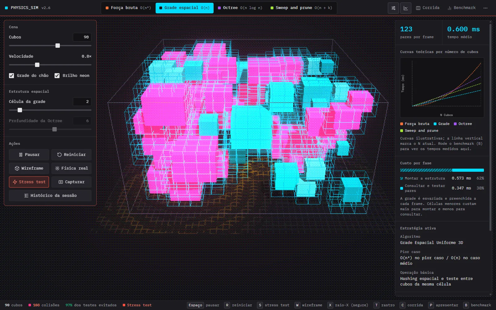

# PHYSICS_SIM

Simulador 3D que compara quatro algoritmos de broad-phase para detecção de colisão: força bruta, grade espacial, Octree e Sweep and Prune. A cena tem até 150 cubos, e o tempo de detecção de cada estratégia é medido a cada frame.

**Abrir o simulador:** https://0110101101100001.github.io/3d-physics-complexity/simulador



Trabalho acadêmico de Física 3D e Análise de Algoritmos, de Kaíque Nunes.

## As quatro estratégias

A broad-phase escolhe quais pares de cubos vale a pena testar. O teste em si é o mesmo para todas: interseção de caixas alinhadas aos eixos (AABB), que compara as projeções em X, Y e Z.

| Estratégia | Resultado clássico | Como funciona |
|---|---|---|
| Força bruta | Θ(n²) | Testa todos os n(n−1)/2 pares. |
| Grade espacial | O(n) | Divide o espaço em células de lado fixo e só testa cubos que dividem uma célula. Cada par é reportado uma vez, na célula do canto mínimo da interseção. |
| Octree | O(n log n) | Divide o espaço em 8 octantes, recursivamente. Um cubo que cruza um plano divisor fica no nó pai. A raiz é um cubo de lado 40 apoiado no chão da arena. |
| Sweep and Prune | O(n + k) | Mantém os cubos ordenados pelo início no eixo X e só testa os que se sobrepõem nesse eixo (k pares). A lista sobrevive entre frames, então a ordenação por inserção quase não troca nada. |

A janela **Prova de complexidade** do simulador (menu ⋯) traz um teorema por estratégia, com a prova:

- Força bruta: Θ(n²) exato, sem hipóteses.
- Grade: O(n) esperado, se nenhuma célula tem mais que K cubos. Todos numa célula: Θ(n²).
- Octree: O(n log n) com divisão balanceada, pelo Teorema Mestre (T(n) = 8T(n/8) + Θ(n), caso 2). Sem balanceamento, pode chegar a Θ(n²).
- Sweep and Prune: O(n + k) por frame, com k = pares sobrepostos no eixo X (k ≥ colisões): a lista fica guardada entre frames e a ordenação por inserção custa O(n) com coerência temporal. Só o primeiro frame, que ordena do zero, custa O(n log n + k).

A aba Verificação roda, para cada estratégia, uma cena que respeita as hipóteses e outra que as viola, e compara a contagem medida com a fórmula da prova. Na arena fixa do simulador a densidade sobe com n e as quatro estratégias são Θ(n²): o que decide quem vence até 150 cubos é a constante.

## O que dá para fazer no simulador

- Trocar de estratégia sem recriar a cena (teclas 1 a 4) e ver os pares testados como linhas entre os cubos.
- Abrir a corrida (C): a tela se divide em quatro colunas, uma por estratégia, rodando sobre os mesmos cubos no mesmo frame.
- Rodar o benchmark (B): mede as quatro estratégias na cena atual e em cenas sintéticas de 10 a 150 cubos, e ajusta t = a·nᵏ em escala log-log. As medições rodam num Web Worker, então a cena não trava.
- Segurar X para o raio-X: os cubos ficam translúcidos e sobra a estrutura da estratégia ativa (células da grade, nós da Octree, régua do Sweep and Prune).
- Acompanhar a telemetria: pares por frame, tempo médio, custo dividido entre montar a estrutura e consultar os pares, e um gráfico assintótico em log-log (N de 10 a 10⁷) com as curvas dos teoremas, as contagens medidas e um botão para violar as hipóteses.
- Ajustar o tamanho da célula da grade e a profundidade da Octree, ligar a física (os cubos passam a quicar uns nos outros), arrastar cubos com o mouse e exportar o histórico da sessão em CSV.

### Cenas prontas por URL

| Parâmetro | Valores | Efeito |
|---|---|---|
| `modo` | `brute`, `grid`, `octree`, `sap` | Estratégia inicial |
| `n` | 2 a 150 | Número de cubos |
| `paineis` | `1` ou `0` | Abre ou fecha os painéis laterais |
| `corrida=1` | | Abre a corrida |
| `apresentacao=1` | | Câmera orbital, sem painéis |
| `fisica=1` | | Liga a resposta a colisões |
| `wireframe=1` | | Mostra só as arestas dos cubos |
| `brilho=0` | | Desliga o brilho neon |
| `rastro=0` | | Desliga o rastro das linhas de teste |
| `raiox=1` | | Abre com o raio-X ligado |

Exemplo: [`simulador?modo=octree&n=60&paineis=1`](https://0110101101100001.github.io/3d-physics-complexity/simulador?modo=octree&n=60&paineis=1)

### Atalhos

| Tecla | Ação |
|---|---|
| `1` a `4` | Força bruta, grade, Octree, Sweep and Prune |
| `Espaço` | Pausar |
| `R` | Reiniciar |
| `S` | Stress test (150 cubos) |
| `W` | Wireframe |
| `X` (segurar) | Raio-X |
| `T` | Rastro das linhas de teste |
| `C` | Corrida |
| `B` | Benchmark |
| `P` | Modo apresentação |
| `Esc` | Fecha janelas e sai da apresentação |

O som só começa depois do primeiro clique, por regra dos navegadores.

## Rodar localmente

Não há etapa de build. As páginas são HTML estático com caminhos relativos; o Three.js e o KaTeX vêm de CDN.

```bash
python -m pip install -r requirements.txt
python app.py              # Waitress em http://127.0.0.1:5000
FLASK_DEBUG=1 python app.py  # servidor de desenvolvimento do Flask
```

`PORT` e `HOST` mudam a porta e o endereço. O simulador fica em `/simulador`.

## Testes

```bash
npm test
```

Usa o `node:test` (Node 20 ou mais novo, sem dependências). Os testes geram cenas com semente e conferem que a grade, a Octree e o Sweep and Prune acham exatamente as mesmas colisões que a força bruta, sem repetir pares, inclusive com as estruturas reaproveitadas ao longo de vários frames. Também conferem os expoentes do experimento de crescimento.

## Publicação

O site vai para o GitHub Pages a cada push na `main`, pelo workflow `.github/workflows/pages.yml`: roda os testes, monta `_site/` com `npm run build:pages` e publica.

## Estrutura

```
app.py                  servidor Flask: / e /simulador
templates/
  index.html            página inicial
  simulador.html        simulador, incluindo o texto da prova de complexidade
static/js/
  broadphase.js         os quatro algoritmos, medição e experimento (sem Three.js nem DOM)
  strategies.js         nomes, cores, notação e pseudocódigo de cada estratégia
  physics.js            estado da cena, movimento, detecção e desenho das estruturas
  three-setup.js        cena, câmera, piso, brilho e pós-processamento
  ui.js                 controles, atalhos, laço de animação e parâmetros de URL
  telemetry.js          médias, custo por fase e gráfico de crescimento
  benchmark.js          painel de benchmark
  bench-worker.js       Web Worker das medições
  proof.js              janela da prova de complexidade
  view-modes.js         corrida e modo apresentação
  history.js, panels.js, menu.js, drag.js, dom.js, fragments.js
test/broadphase.test.js testes dos algoritmos
scripts/build-pages.mjs monta o site estático
```

O mesmo `broadphase.js` roda na página, no Web Worker e nos testes do Node.

## Tecnologias

JavaScript com módulos ES, sem framework nem bundler. [Three.js](https://threejs.org/) r170 por import map, [KaTeX](https://katex.org/) 0.16.11 para as fórmulas, fontes IBM Plex. Flask e Waitress para rodar localmente.
