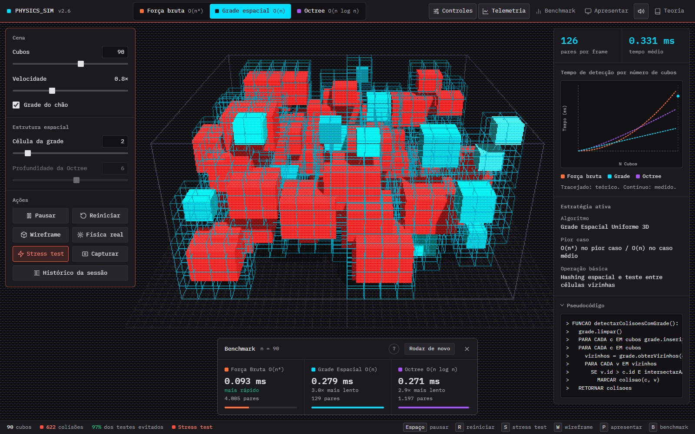

# PHYSICS_SIM v2.6 — Detecção de Colisão 3D & Análise Assintótica

Ferramenta de demonstração empírica e telemetria em tempo real para algoritmos de *Broad-Phase* em física 3D. Compara a eficiência de Força Bruta $O(n^2)$, Grade Espacial Uniforme $O(n)$ e Octree 3D $O(n \log n)$ através de medição por frame com `performance.now()` e renderização de curvas assintóticas comparativas.


Construído em JavaScript vanilla (ES6+) com Three.js r128, sem bundler e sem dependências de front-end além de CDN. É servido por um pequeno servidor Flask, que renderiza o template e os arquivos estáticos.

---

## Arquitetura & Algoritmos

### Fase Estreita (Narrow-Phase)

Intersecção **AABB** (*Axis-Aligned Bounding Box*) testando sobreposição nos eixos X, Y e Z entre pares de objetos.

### Estratégias Broad-Phase

| Estratégia | Complexidade | Abordagem |
|---|---|---|
| Força Bruta | $O(n^2)$ | Verificação par-a-par total via combinação $\frac{N(N-1)}{2}$ |
| Grade Espacial | $O(n)$ | Mapeamento e hashing de células 3D fixas com consulta de vizinhança |
| Octree | $O(n \log n)$ | Subdivisão recursiva de 8 octantes com retenção em nós pai para evitar *straddling* |

---

## Recursos da Interface

**Layout**
- Bancada de instrumento em volta da cena: teclas de estratégia na barra superior, controles no trilho esquerdo, telemetria no trilho direito e leituras com atalhos no rodapé. O centro da cena fica livre.
- Superfícies matte opacas, IBM Plex Mono na interface e IBM Plex Sans na teoria (as mesmas fontes da página inicial), uma cor por estratégia vinda de `body[data-mode]`.
- Em telas largas os dois trilhos abrem sozinhos; nas menores a cena começa livre e a barra superior passa a duas linhas.

**Telemetria em Tempo Real**
- Canvas 2D com as curvas assintóticas teóricas das três estratégias e um marcador do N atual. O gráfico é estático: os tempos medidos ficam nas leituras, no benchmark e na corrida.
- Rodapé com contador de cubos, colisões e porcentagem de testes evitados, sempre visível.
- Trilho de telemetria: pares testados por frame, tempo médio em ms, gráfico, estratégia ativa e pseudocódigo.

**Controles Inteligentes**
- Bloqueio dinâmico dos sliders de parâmetros espaciais (Célula da grade e Profundidade da Octree) conforme a estratégia selecionada. Ambos bloqueados em Força Bruta.
- Indicador de economia no rodapé: porcentagem de testes de colisão evitados; fica cinza em Força Bruta.

**Notificações (Toast HUD)**
- Feedback em tempo real para pausa/retomada, ativação/desativação da física real e troca de algoritmo.

**Benchmark & Exportação**
- Painel de benchmark com as três estratégias lado a lado. Cada tempo é a média de pelo menos 20 execuções, repetidas até somar tempo suficiente para vencer a resolução do relógio do navegador.
- **Custo por fase:** o tempo de detecção é separado em montar a estrutura e consultar os pares. Aparece como barra empilhada no trilho de telemetria (média dos últimos 180 frames), no benchmark e no placar da corrida.
- **Ajuste empírico da curva:** o benchmark mede cenas sintéticas de 10 a 150 cubos, ajusta `t = a·n^k` por mínimos quadrados em escala log-log e mostra o expoente medido de cada estratégia ao lado do teórico, com R² e o gráfico log-log. As cenas usam a arena fixa do simulador, então a densidade cresce com N e a grade e a Octree medem acima do caso médio teórico.
- Exportação do histórico de telemetria da sessão para CSV.

**Modos de Operação**
- **Modo Apresentação:** câmera orbital automática com HUD limpo.
- **Corrida:** a tela se divide em três colunas, uma por estratégia. A simulação é uma só: as três estratégias rodam no mesmo frame sobre os mesmos cubos, e cada coluna mostra os pares que a sua estratégia testou, a estrutura que ela montou e um placar com pares, tempo médio e custo por fase.
- **Stress Test:** suporte a até 150 objetos simultâneos com efeitos visuais de sobrecarga.

**Efeitos Visuais**
- **Brilho neon:** linhas de teste, gizmos, cubos em colisão, faíscas e a crista das ondas do piso emitem luz (bloom seletivo, aplicado antes do dithering). Quanto mais pares uma estratégia testa, mais a cena acende. Pode ser desligado no painel de controles ou com `brilho=0`.
- **Piso reativo:** cada colisão solta uma ondulação que se espalha pela grade do chão a partir do ponto de impacto.
- **Troca de estratégia com glitch:** meio segundo de separação RGB e faixas deslocadas, enquanto os cubos trocam de paleta em onda, do centro para fora. A cena não é recriada: a estratégia nova roda sobre os mesmos cubos. Com `prefers-reduced-motion` o glitch não acontece.
- **Raio-X (segure X):** a cena apaga, os cubos ficam translúcidos e sobra a estrutura da estratégia ativa: as células da grade e os nós da Octree se enchem de luz conforme os pares que testam, as arestas da Octree acendem mais nos níveis de cima e as linhas da força bruta ficam mais fortes. Os cubos em colisão continuam visíveis. `raiox=1` na URL abre com ele ligado.
- **Rastro de fósforo (T):** as linhas dos pares testados deixam um rastro que some em ~0,8 s, como num osciloscópio. Fica mais forte quando há poucas linhas (grade, Octree) e enfraquece com milhares (força bruta) e no raio-X, para não estourar o brilho. Ligado por padrão; `rastro=0` na URL desliga.
- **Estilhaços:** com a física real ligada, colisões fortes soltam fragmentos que quicam e somem. São só visuais e ficam fora da detecção e dos tempos medidos.

**Outros Recursos**
- Arrastar e largar cubos na cena 3D.
- Toggle wireframe, grade do chão opcional, física real ligada/desligada.
- Modal de teoria com sete blocos explicativos (fecha com Esc ou clicando fora).
- Terminal de pseudocódigo com efeito de digitação ao trocar de estratégia.
- Página inicial separada do simulador, com capturas reais da cena.

---

## Estrutura do Projeto

```
3d-physics-complexity-main/
├── app.py                  # Servidor Flask: / (página inicial) e /simulador
├── README.md               # Este arquivo
├── scrollcraft/            # Brief da versão com animações de rolagem (não usada no momento)
├── templates/
│   ├── index.html          # Página inicial (feita com o kit da tasteskill)
│   └── simulador.html      # Simulador: top bar, painel bento, gráfico, modais, overlays
└── static/
    ├── favicon.svg
    ├── img/                # Capturas reais do simulador (hero-seq/ só era usado pela versão scroll-craft)
    ├── data/               # broadphase-150.json: pares reais de runBroadPhase (não usado no momento)
    ├── scrollcraft/        # Motor scroll-craft (MIT; não carregado no momento)
    ├── landing/            # Kit da tasteskill (MIT, ver LICENSE-taste-skill): CSS, JS, momento e fragmento de código
    ├── css/
    │   ├── style.css       # Simulador: tokens, cena (canvas, vinheta, scanlines), barra superior, trilhos, rodapé
    │   └── components.css  # Simulador: controles, botões, leituras, gráfico, benchmark, avisos, modais, HUD
    └── js/
        ├── main.js         # Orquestrador de módulos ES (importa three-setup, physics, ui)
        ├── three-setup.js  # Cena Three.js, câmera, renderer, piso reativo, pós-processamento (brilho, glitch, dithering Bayer 4×4)
        ├── fragments.js    # Estilhaços das colisões fortes (InstancedMesh, só visual)
        ├── physics.js      # Estado da simulação, AABB, SpatialGrid, Octree, detecção de colisões
        ├── ui.js           # UI, eventos, animação, toasts, benchmark, CSV, parâmetros de URL
        ├── glitch.js       # Página inicial: o glitch da troca de estratégia como filtro SVG (texto e imagem)
        ├── hero-strategies.js # Página inicial: abas de estratégia do hero, trocando a captura com glitch
        └── landing.js      # Animações da versão scroll-craft (não carregado no momento)
```

---

## Como Executar

Não há etapa de *build*: as bibliotecas carregam via CDN ou de `static/`. As páginas usam caminhos absolutos (`/static/...`), então precisam de um servidor; o Flask é o previsto.

```bash
# Instalar dependência
python -m pip install flask

# Executar servidor
python app.py

# Acessar
http://localhost:5000            # página inicial
http://localhost:5000/simulador  # simulador
```

### Cenas prontas por URL

O simulador aceita parâmetros para abrir um estado específico (útil em aula ou para capturas):

| Parâmetro | Valores | Efeito |
|---|---|---|
| `modo` | `brute`, `grid`, `octree` | Estratégia de broad-phase |
| `n` | 2 a 150 | Número de cubos (acima de 20 liga o stress test) |
| `paineis` | `1`, `0` | Abre ou fecha os dois trilhos laterais (controles e telemetria) |
| `fisica=1` | | Liga a resposta a colisões |
| `wireframe=1` | | Liga o wireframe |
| `corrida=1` | | Abre a corrida com as três estratégias lado a lado |
| `brilho=0` | | Desliga o brilho neon |
| `apresentacao=1` | | Entra no modo apresentação |

Exemplo: `/simulador?modo=octree&n=60&paineis=1`.

> **Nota:** o contexto de áudio dos navegadores modernos requer interação do usuário; o som começa depois do primeiro clique na página.

---

## Atalhos de Teclado

| Tecla | Ação |
|---|---|
| `Espaço` | Pausar / Retomar simulação |
| `R` | Reiniciar simulação (8 cubos, velocidade padrão) |
| `S` | Ativar / Desativar Stress Test (150 objetos) |
| `W` | Alternar modo Wireframe |
| `C` | Entrar / Sair da Corrida |
| `B` | Rodar o benchmark e o ajuste da curva |
| `P` | Entrar / Sair do Modo Apresentação |
| `Esc` | Sair do Modo Apresentação |

---

## Tecnologias

| Recurso | Versão / Fonte |
|---|---|
| [Three.js](https://threejs.org/) | r128 (CDN cdnjs) |
| OrbitControls | r128 (CDN jsdelivr) |
| EffectComposer + ShaderPass | r128 (CDN jsdelivr) — pós-processamento dithering Bayer 4×4 |
| UnrealBloomPass | r128 (CDN jsdelivr) — brilho neon |
| Fira Code | Google Fonts — monospace para terminal e UI técnica |
| Inter | Google Fonts — tipografia geral da interface |
| JavaScript | Vanilla ES6+, módulos ES, sem framework ou bundler |
| Flask | Servidor de template para `templates/index.html` |

---

## Autor

Kaíque Nunes

Trabalho Acadêmico — Física 3D / Análise de Algoritmos
