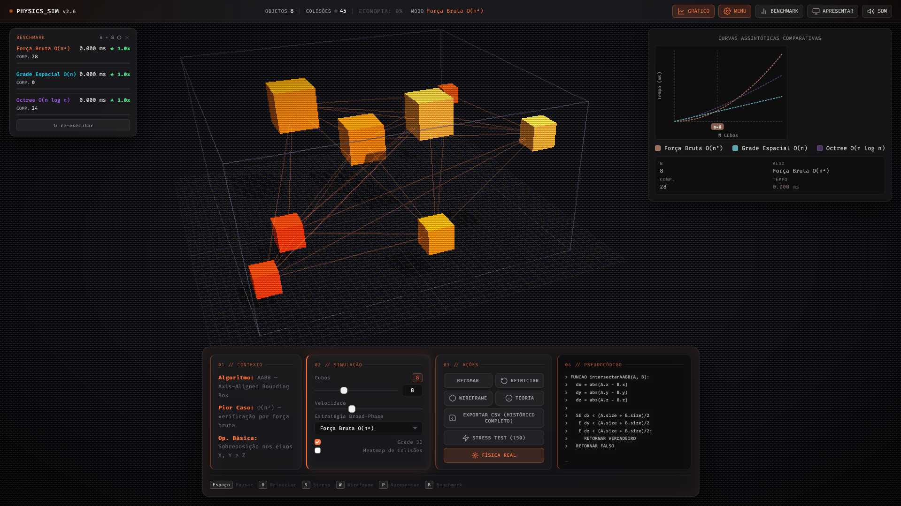

# Detecção de Colisão 3D — Prova Matemática de Eficiência

> Simulação interativa em 3D que demonstra e compara três estratégias de *Broad-Phase* para detecção de colisões AABB, com telemetria em tempo real e estética retro PS2.


---

## 📸 Screenshot



---

## Sobre o Projeto

Este projeto é uma simulação de física 3D desenvolvida como trabalho académico para demonstrar, de forma visual e mensurável, o impacto da escolha de algoritmos de *Broad-Phase* na deteção de colisões entre objetos. A aplicação renderiza caixas delimitadoras alinhadas por eixos (AABB — *Axis-Aligned Bounding Box*) num espaço tridimensional e permite ao utilizador alternar em tempo real entre três estratégias de deteção, observando como o desempenho varia conforme o número de objetos aumenta.

O contexto académico é o estudo da complexidade assintótica aplicada a motores de física. A simulação torna tangível a diferença entre um algoritmo O(n²), que colapsa com o crescimento de N, e estruturas espaciais como Grade Uniforme e Octree, que escalam de forma muito mais eficiente. Toda a lógica de colisão é medida por frame com `performance.now()`, e os dados acumulados alimentam um gráfico de curvas assintóticas comparativas atualizado continuamente.

A aplicação foi construída inteiramente em JavaScript vanilla com Three.js, sem nenhuma dependência de *build*, e inclui uma estética visual inspirada nos consoles PS2 — renderização em baixa resolução com *dithering* de Bayer 4×4, névoa volumétrica e paletas de cores distintas por modo de algoritmo. O resultado é uma ferramenta ao mesmo tempo didática e visualmente impactante, adequada para apresentações académicas.

---

## Conceitos Demonstrados 📐

- **AABB (Axis-Aligned Bounding Box)** — operação básica de interseção testando sobreposição nos eixos X, Y e Z
- **Força Bruta O(n²)** — compara todos os objetos contra todos; crescimento quadrático via Progressão Aritmética `(N × (N-1)) / 2`
- **Grade Espacial Uniforme O(n)** — mapeia objetos em células de hash 3D; restringe testes AABB apenas aos 27 vizinhos locais
- **Octree O(n log n)** — particionamento hierárquico recursivo em 8 octantes; adapta-se dinamicamente à densidade da cena
- **Notação Big-O** — gráfico de curvas teóricas (tracejadas) e medições reais (linha sólida) sobrepostas por estratégia
- **Constantes ocultas e ponto de interseção** — overhead de construção das estruturas espaciais torna a Força Bruta temporariamente mais rápida para valores pequenos de N, até as curvas se cruzarem

---

## Funcionalidades

**Simulação 3D**
- Renderização com Three.js com efeito de *dithering* Bayer 4×4 e névoa volumétrica (estética PS2)
- Cubos com física simples (velocidade, rebote nas fronteiras do espaço), cores distintas por estratégia e animação de *spawn*
- Interação por arrastar e largar (*drag & drop*) os cubos diretamente na cena 3D
- Toggle de modo *wireframe*
- Grelha 3D opcional

**Estratégias de Broad-Phase**
- Força Bruta O(n²)
- Grade Espacial Uniforme O(n)
- Particionamento Hierárquico Octree O(n log n)
- Tema de cores da UI muda automaticamente conforme o algoritmo selecionado

**Telemetria em tempo real (barra superior)**
- Contador de objetos ativos
- Contador de colisões detetadas com pulso visual a cada nova colisão
- Modo de algoritmo ativo

**Gráfico Assintótico**
- Curvas teóricas tracejadas para O(n²), O(n log n) e O(n)
- Linhas sólidas com médias aparadas das medições reais por algoritmo
- Ponto marcado no N atual, linha vertical e *badge* com valor de N
- Painel de telemetria lateral: N, algoritmo ativo, número de comparações, tempo médio em ms

**Stress Test**
- Botão "STRESS TEST (150)" que eleva o limite de cubos para 150 objetos
- Badge de aviso "STRESS" na barra superior e efeito visual de flash ao ativar/desativar

**Modo Apresentação**
- Câmera em órbita automática ao redor da cena
- HUD minimalista com modo, N, comparações e colisões totais
- Restaura posição original da câmera ao sair

**Exportação CSV**
- Registo automático dos dados de simulação (timestamp, N, algoritmo, comparações, tempo em ms, colisões ativas) sempre que N ou algoritmo mudam
- Exportação do histórico completo da sessão como arquivo `.csv`

**Modal de Teoria**
- Seis blocos explicativos: problema Broad-Phase, Força Bruta, Grade Espacial, Octree, constantes ocultas e ponto de interseção, validação pela telemetria

**Terminal de Pseudocódigo**
- Painel com pseudocódigo do algoritmo ativo, com efeito de digitação ao trocar de estratégia

**Landing Page**
- Tela de entrada animada com contadores de objetos e estratégias antes de iniciar a simulação

---

## Atalhos de Teclado ⌨️

| Tecla | Ação |
|-------|------|
| `Espaço` | Pausar / Retomar a simulação |
| `R` | Reiniciar a simulação (8 cubos, velocidade padrão) |
| `S` | Ativar / Desativar Stress Test (150 objetos) |
| `W` | Alternar modo Wireframe |
| `P` | Entrar / Sair do Modo Apresentação |
| `Esc` | Sair do Modo Apresentação |

---

## Como Executar

Não há etapa de *build*. A aplicação carrega todas as dependências via CDN.

1. Clone ou descarregue este repositório
2. Abra o arquivo `index.html` diretamente no browser (Chrome ou Firefox recomendados)

```
# Exemplo no Windows
start index.html

# Exemplo no macOS
open index.html
```

> **Nota:** algumas funcionalidades de áudio podem requerer interação do utilizador antes de serem ativadas (limitação dos browsers modernos). Clique no botão "Iniciar Simulação" na landing page para garantir que o contexto de áudio é criado corretamente.

---

## Estrutura do Projeto

```
Colisao3D/
├── index.html   # Estrutura HTML completa: landing page, top bar, painel de controlos,
│                #   gráfico, modal de teoria, overlay do modo apresentação e scripts CDN
├── main.js      # Toda a lógica da aplicação: configuração Three.js, física dos cubos,
│                #   algoritmos AABB (Força Bruta, Grade Espacial, Octree), pós-processamento
│                #   (dithering), gráfico assintótico, exportação CSV e gestão de eventos
├── style.css    # Estilos da UI: tema escuro, bento grid, animações, variáveis CSS por modo
└── README.md    # Este arquivo
```

---

## Tecnologias

| Biblioteca / Recurso | Versão / Fonte |
|---|---|
| [Three.js](https://threejs.org/) | r128 (CDN cdnjs) |
| OrbitControls | r128 (CDN jsdelivr) |
| EffectComposer + ShaderPass | r128 (CDN jsdelivr) — dithering Bayer 4×4 |
| Fira Code | Google Fonts — fonte monospace do terminal e gráfico |
| Inter | Google Fonts — fonte da UI geral |
| JavaScript | Vanilla ES6+, sem framework ou bundler |

---

## Autor

> Kaíque Nunes

---

*Trabalho Académico — Física 3D / Análise de Algoritmos*
